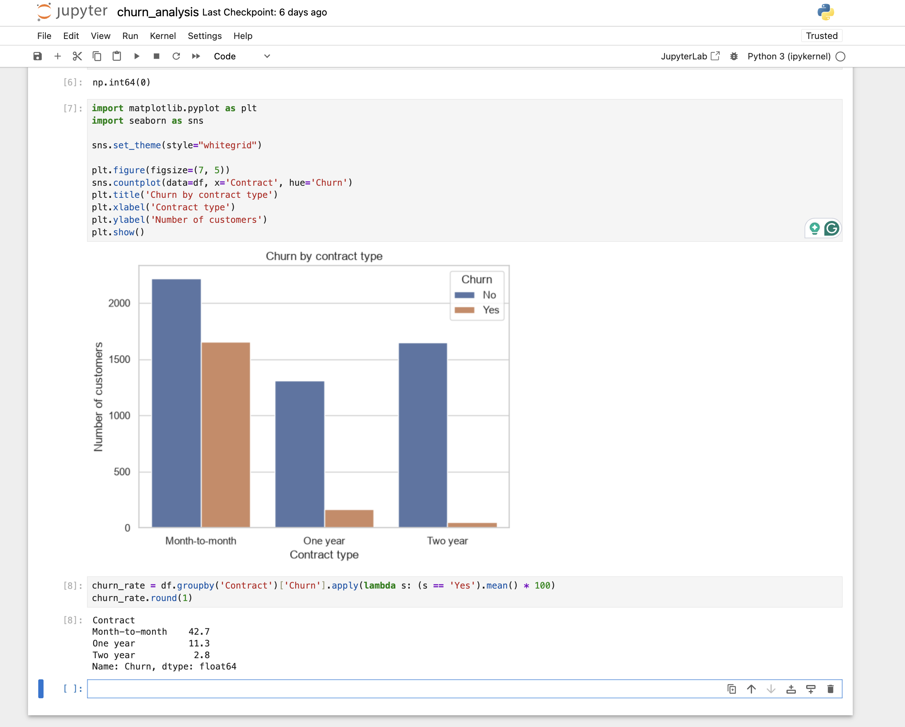
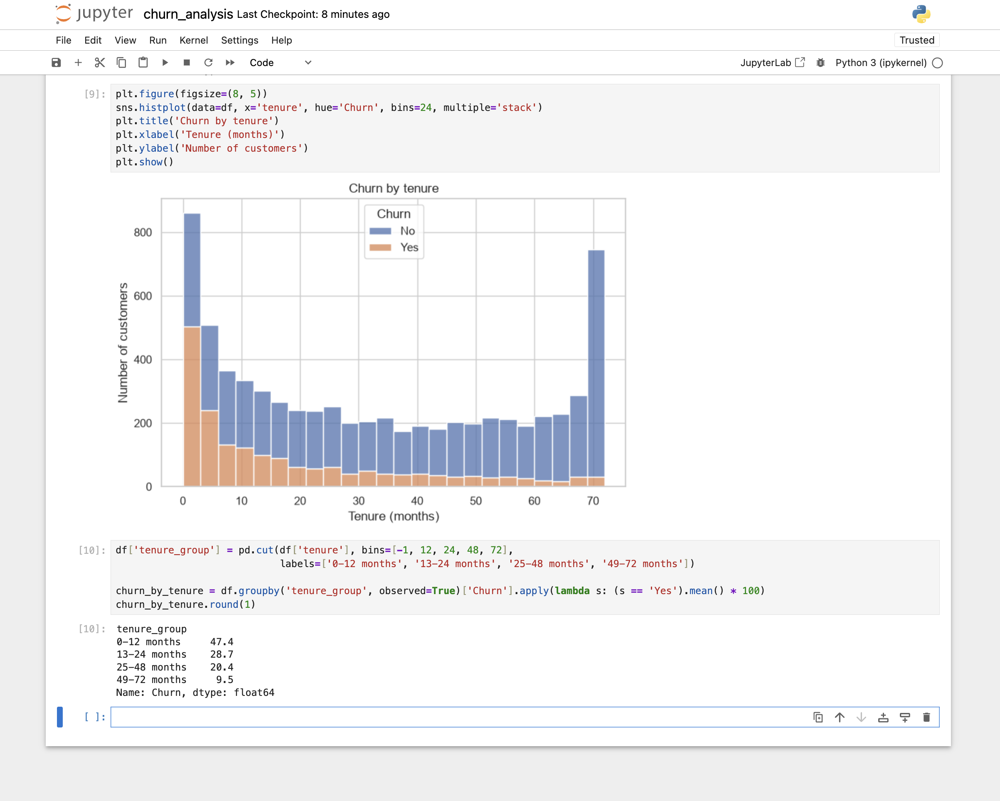
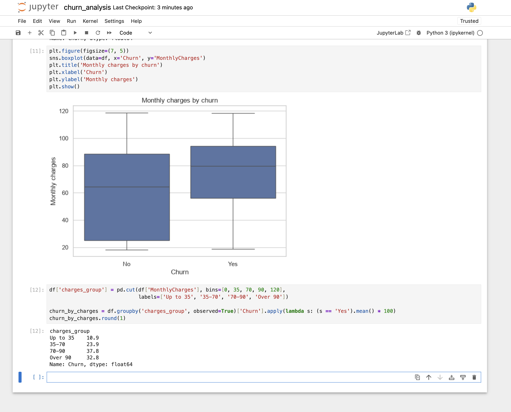
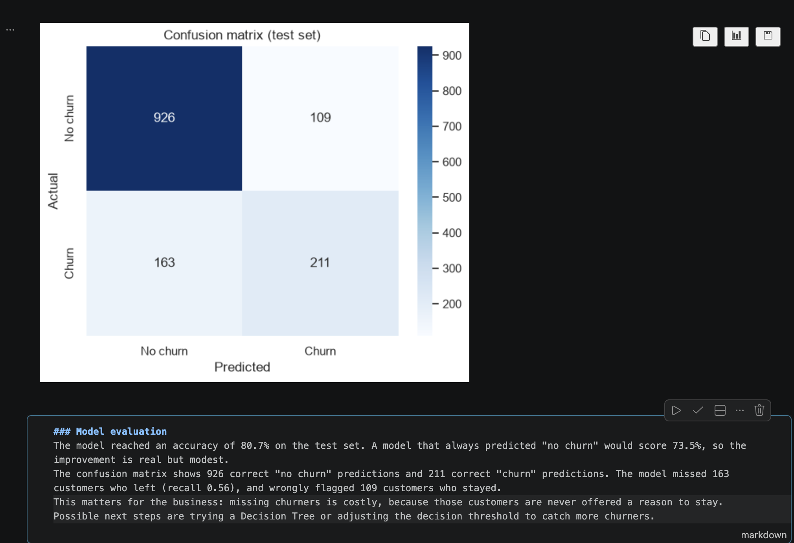

# Customer Churn Prediction and Visualisation

A Python mini-project that explores why telecom customers leave (churn), visualises the main factors, and trains a simple machine learning model to predict churn. Built for the PFD200 Professional Development portfolio (FdSc Computing).

## Dataset
Telco Customer Churn, a publicly available sample dataset (7,043 customers, 21 columns). The file is in `data/`. It contains no real customer data.

## What the notebook does
1. Loads and inspects the data with pandas.
2. Cleans the data (blank `TotalCharges` values converted to numbers and filled with 0).
3. Explores churn by contract type, tenure and monthly charges (matplotlib, seaborn).
4. Prepares the data: removes `customerID`, encodes text columns, splits 80/20 into train and test sets.
5. Trains a Logistic Regression model (scikit-learn).
6. Evaluates it with accuracy, a classification report and a confusion matrix.

## Results
- Accuracy on the test set: **80.7%** (a model that always predicts "no churn" would score 73.5%).
- Recall for churn: **0.56**, so the model finds about 56% of the customers who leave and misses 163 of 374.
- This is a first, simple model. Next steps: try a Decision Tree and adjust the decision threshold.

## Screenshots





## How to run
```bash
git clone https://github.com/gabrielle-bertocchi/pfd200-churn-prediction.git
cd pfd200-churn-prediction
python3 -m venv venv
source venv/bin/activate
pip install -r requirements.txt
jupyter notebook
```
Then open `churn_analysis.ipynb` and choose Run All.

## Data privacy
`customerID` is removed before modelling and not printed in the notebook. No tokens or credentials are stored in this repository.

## Author
Gabrielle Bertocchi Sales, FdSc Computing, Elizabeth School of London (NCG).